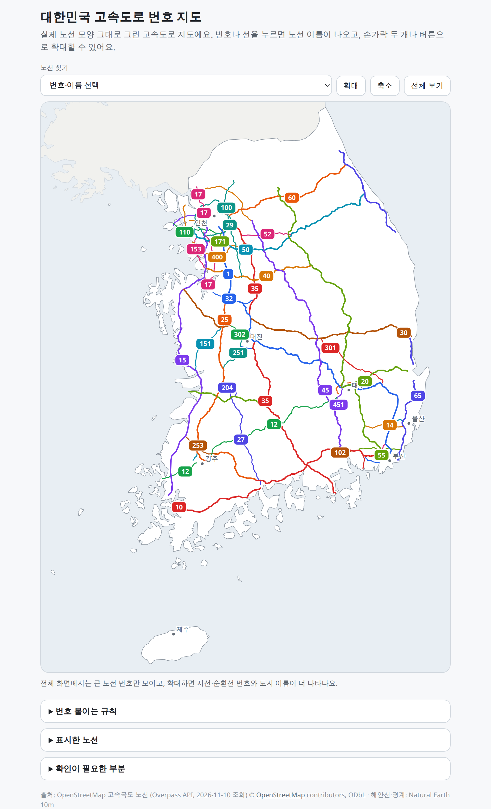

# 대한민국 고속도로 번호 지도

Interactive map of South Korean expressways, drawn from real OpenStreetMap route geometry, with number shields that show the road name.

Live site: https://ys-laube.github.io/korea-expressway/



## Features

- Expressway lines follow the OpenStreetMap geometry.
- Tap a number shield or a line to show the road name, plus the former name and alias when OpenStreetMap has them.
- Find a route from the dropdown and zoom to it.
- Zoom with the mouse wheel, a pinch, or the on-page buttons. Pan by dragging.
- The country view shows the main route numbers. Zoom in for branch and beltway numbers and more city names.
- The page also lists the numbering rules, the routes drawn, and segments that still need a closer look.

## Data and attribution

- Expressway routes: © [OpenStreetMap](https://www.openstreetmap.org/copyright) contributors, retrieved with the Overpass API on 2026-11-10. Available under the [Open Database License (ODbL)](https://opendatacommons.org/licenses/odbl/1.0/).
- Coastline and borders: [Natural Earth](https://www.naturalearthdata.com/) 10m, public domain.
- The code in this repository is [MIT](LICENSE) licensed. That license does not relicense the OpenStreetMap data.

Names, former names, and aliases are the OpenStreetMap tags from that retrieval. Lengths and opening years are not included. Segments that were not drawn as open roads are omitted, so some routes look broken in the middle. Ulleungdo and Dokdo are outside the map frame.

## Run locally

There is no build step and no install. From the repository root:

```sh
python3 -m http.server
```

Open the URL the server prints, usually http://127.0.0.1:8000/. The page loads `data.json` with `fetch`, so opening `index.html` as a local file will not show the map.

## How the data was generated

This repository does not include a generation script. `data.json` is a checked-in snapshot:

- `kor` and `prk` are coastline and boundary paths from Natural Earth 10m.
- `cities` are label positions.
- `R` is one entry per expressway: route number, OpenStreetMap name, former name, alias, path, and shield positions.

Refreshing the geometries means querying OpenStreetMap again and replacing that file. Nothing here does that automatically.

## GitHub Pages

`.github/workflows/deploy-pages.yml` checks `data.json` and `index.html`, then publishes the static files with `actions/upload-pages-artifact` and `actions/deploy-pages`. The public URL stays https://ys-laube.github.io/korea-expressway/.

The repository still publishes from the `main` branch. After this workflow is on `main`, open **Settings → Pages → Build and deployment → Source** and choose **GitHub Actions**, then re-run **Deploy to GitHub Pages**. Until that switch, the branch publisher keeps serving the site and the Actions deploy job cannot replace it.
